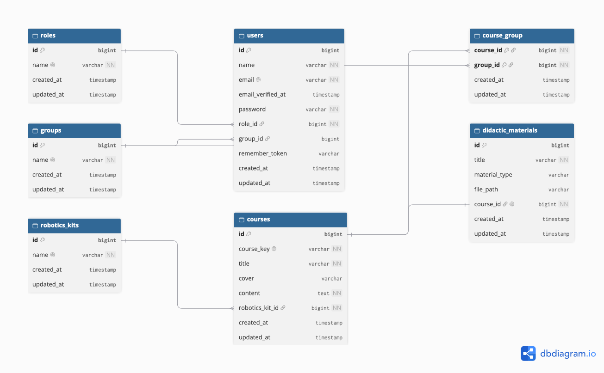

# Activity 7 – Robotics School Database

This repository contains the Laravel 7 project developed for Activity 7 of the Web Application Design course. The project models the relational database required by a small robotics school using Eloquent ORM.

## Student Information

- **Student:** Giovanna Ocampo Lopez
- **Student ID:** AL03009988
- **Course:** Web Application Design
- **Lecturer:** Jonathan Alexis Puente Guerrero
- **Activity:** Activity 7

## Project Description

The purpose of this project is to model a platform for a robotics school. The platform manages users with student, teacher, or administrator roles. Students can belong to groups, groups can have several courses, and every course is associated with a robotics kit and didactic material.

## Main Entities

- Users
- Roles
- Groups
- Courses
- Robotics kits
- Didactic materials

The `course_group` table supports the many-to-many relationship between courses and groups.

## Technologies

- PHP
- Laravel 7
- Eloquent ORM
- MySQL
- MySQL Workbench
- Git and GitHub

## ER Diagram

The following diagram represents the entities, attributes, primary keys, foreign keys, and relationships used in the project.



## Database

The database structure was created through Laravel migrations. The exported MySQL database is available in:

```text
database/activity7.sql
```

## Project Setup

Install the project dependencies:

```bash
composer install
```

Create the environment file:

```bash
cp .env.example .env
```

Generate the application key:

```bash
php artisan key:generate
```

Configure the MySQL connection in `.env`, and then execute the migrations:

```bash
php artisan migrate
```

## Repository

GitHub repository:

https://github.com/kellyocampo190-lab/activity7
